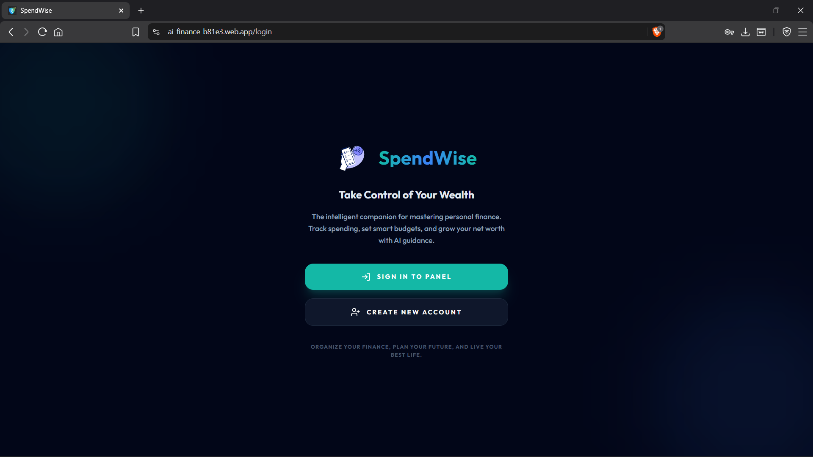
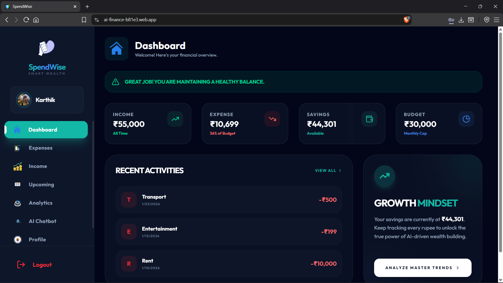
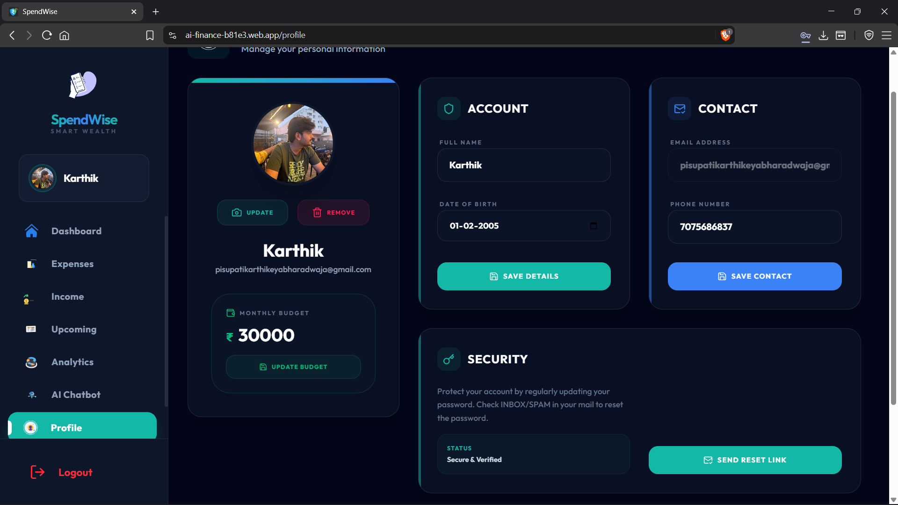

# 💰 SpendWise — AI-Powered Personal Finance Manager

**Spend smarter. Save better. Take control of your finances.**

SpendWise is an AI-powered personal finance management web application designed to help users track income and expenses, analyze spending patterns, manage upcoming payments, and gain insights into their financial habits through an intuitive dashboard.

🌐 **Live Demo:** [SpendWise](https://ai-finance-b81e3.web.app/)

💻 **GitHub Repository:** [SpendWise](https://github.com/Karthik564125/SpendWise)

---

## 📸 Screenshots

Explore the different pages and features of SpendWise.

### 🏠 Landing Page



### 📊 Dashboard



### 💸 Expense Management

| Expense Page | Add Expense |
|---|---|
|  |  |

### 💵 Income Management

| Income Page | Add Income |
|---|---|
|  |  |

### 📈 Analytics


### 🤖 AI Chatbot


### 📅 Upcoming Payments

| Upcoming Payments | Add Upcoming Payment |
|---|---|
|  |  |

### 👤 User Profile



### ℹ️ About Us


---

## ✨ Features

- **Personal Finance Dashboard** — View an overview of your financial activity.
- **Income Tracking** — Record and manage income transactions.
- **Expense Tracking** — Add, organize, and monitor expenses.
- **Financial Analytics** — Analyze spending patterns and financial trends.
- **AI Chatbot** — Interact with an AI-powered assistant for financial guidance.
- **Upcoming Payments** — Keep track of future payments and financial commitments.
- **User Profile** — Manage your personal account information.
- **Responsive Interface** — Navigate financial tools through a unified web interface.

## 🛠️ Tech Stack

| Technology | Purpose |
|---|---|
| React | Frontend user interface |
| Vite | Development server and build tooling |
| JavaScript | Application logic |
| Firebase Authentication | User authentication |
| Firebase Hosting | Frontend deployment |
| Node.js | Backend runtime |
| Express.js | Backend API |
| Google Gemini API | AI-powered functionality |
| Render | Backend hosting |

> The technology list should reflect the actual dependencies and services used in the repository. Remove any technologies that are not part of the current implementation.

## 🚀 Getting Started

### Prerequisites

- Node.js and npm
- Git
- Firebase project configuration, if required
- API credentials for any enabled AI features

### 1. Clone the repository

```bash
git clone https://github.com/Karthik564125/SpendWise.git
```

### 2. Navigate to the project directory

```bash
cd SpendWise
```

### 3. Install dependencies

```bash
npm install
```

### 4. Configure environment variables

Create the required environment files for the frontend and backend according to the project's configuration.

For Vite frontend variables, use the `VITE_` prefix where appropriate.

**Important:** Never commit API keys, private credentials, or production secrets to GitHub.

### 5. Start the development server

```bash
npm run dev
```

Open the local URL displayed in your terminal to access the application.

### 6. Build for production

```bash
npm run build
```

The production build will be generated in the `dist/` directory by default.

> If the backend is maintained in a separate directory, install its dependencies and start the backend separately using its configured scripts.

## 📁 Project Structure

```text
SpendWise/
├── public/
├── screenshots/
│   ├── about us.png
│   ├── analytics page.png
│   ├── chatbot page.png
│   ├── dashboard.png
│   ├── expense adding.png
│   ├── expense page.png
│   ├── income adding.png
│   ├── income page.png
│   ├── landing.png
│   ├── profile.png
│   ├── upcoming page.png
│   └── upcoming payment adding.png
├── src/
├── package.json
├── README.md
└── ...
```

*Note: This is a simplified overview. The actual project may contain additional directories and configuration files.*

## 🔐 Security

- Store sensitive credentials in environment variables.
- Never expose private API keys in client-side code.
- Apply appropriate authentication and authorization checks.
- Validate user input and protect backend endpoints.

## 🎯 Project Objective

SpendWise aims to make personal finance management more accessible by combining transaction tracking, financial visualization, and AI-assisted guidance in a single application.

The project demonstrates practical experience in frontend development, backend integration, cloud deployment, and AI-powered application development.

## 👨‍💻 Author

**Karthik**

- GitHub: [@Karthik564125](https://github.com/Karthik564125)

---

⭐ If you find SpendWise interesting, consider starring the repository!

